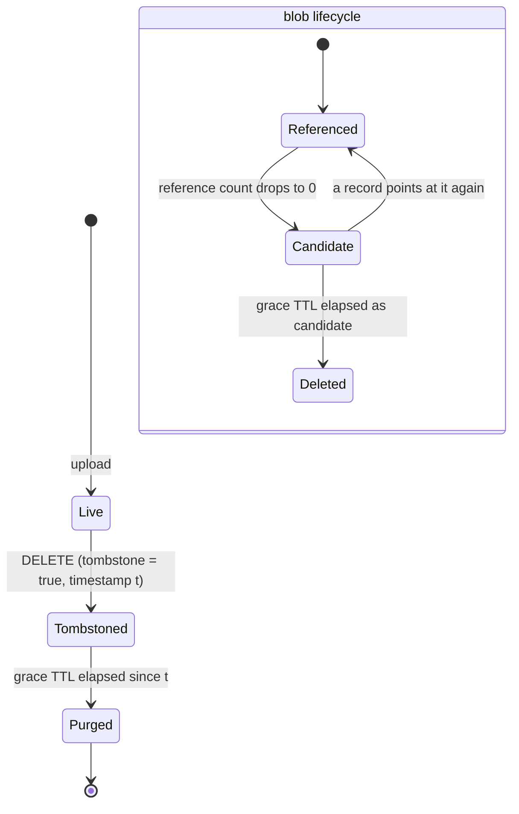
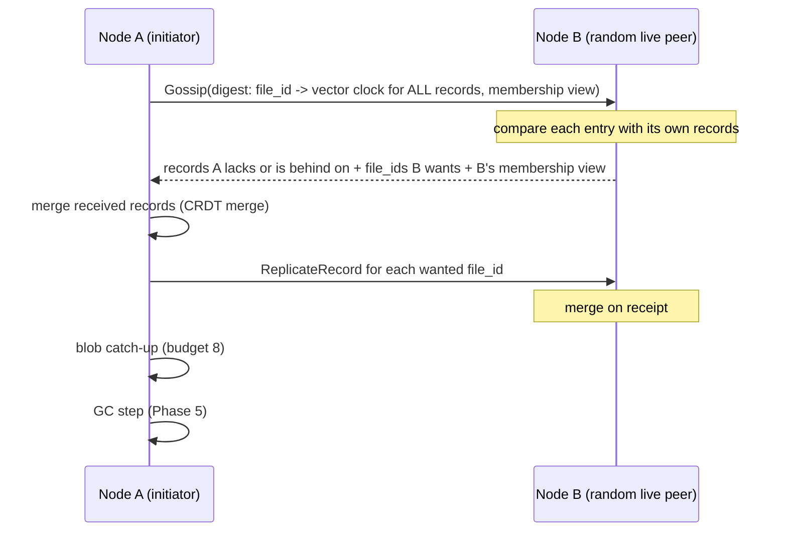

# Architecture

This document describes the system end to end, as it is built: what a node is,
how data is identified and placed, what happens on every read and write, how
replicas converge, how failures are detected and repaired, how deletion works,
and — just as important — what the system does **not** guarantee.

It complements, rather than replaces, the design spec
(`docs/superpowers/specs/2026-09-28-tag-based-distributed-store-design.md`): the
spec records the decisions and their rationale as they were made; this document
describes the resulting system as one piece, and every statement in it is meant
to match the code under `almacen/`. Where the implementation deliberately
departs from the spec, this document says so.

The comparison with CephFS, IPFS and semantic file systems requested by the
assignment is in [comparison.md](comparison.md). How to deploy a cluster is in
[deployment.md](deployment.md).

**Scope note.** Phases 1-4 are implemented. Phase 5 (tombstone purge and blob
garbage collection) is described here according to its implementation plan,
`docs/superpowers/plans/2026-09-29-phase5-deletion-and-gc.md`; section 9 marks
the parts that come from that plan.

---

## 1. The problem, in one paragraph

Each file has a stable identity, content, a name and a set of tags. Clients can
upload, download, rename, replace content, delete, add and remove tags, and list
files matching a combination of tags. The cluster must keep working when nodes
fail or the network partitions, must handle concurrent updates to the same file
on different nodes, and must reconcile divergent replicas once the partition
heals. Content and metadata are replicated differently, so their freshness can
diverge, and the design has to state what a client can observe when it does.

## 2. Design at a glance

| Concern | Decision | Section |
| --- | --- | --- |
| Consistency model | AP, eventually consistent, Dynamo-style | 3 |
| Node roles | One node type; every node is both a data node and a metadata node | 4 |
| Identity | Stable UUID per file, separate from the SHA-256 of its content | 5 |
| Content placement | Rendezvous hashing (HRW) of the content hash, R=3 of N=5 | 6 |
| Content durability | Write quorum W=2 of R=3; read from any one replica, verified by hash | 7 |
| Metadata placement | Full replica on every node | 4, 7 |
| Concurrent updates | CRDTs: LWW-registers, OR-Set of tags, vector clock per record | 8 |
| Failure detection | SWIM-style suspicion with incarnation-based refutation | 10 |
| Repair | Push-pull gossip of `file_id → vector clock` digests, plus blob catch-up | 11 |
| Deletion | Tombstones, grace TTL, reference-counted blob GC | 9 |
| Interfaces | REST (FastAPI) for clients, gRPC between nodes | 4 |
| Deployment | One Docker image, one `docker run` per node, no orchestration file | 13 |

## 3. Consistency model: why AP

The assignment explicitly asks for *treatment of concurrent updates* and
*reconciliation after partitions*. Both presuppose that replicas are allowed to
diverge. A CP design (Raft, Paxos, majority quorums on every operation) would
make the minority side of a partition refuse writes, so there would be nothing
to reconcile afterwards. The system is therefore built AP:

- **Every node accepts metadata operations** (rename, tag edits, delete,
  queries) as long as it is running, even when it is cut off from every peer.
- **Divergence is resolved after the fact** by merge functions that are
  commutative, associative and idempotent (CRDTs), so the order and number of
  times updates arrive do not matter.
- **Content writes are the exception that needs a quorum**: an upload succeeds
  only if W of the blob's R replicas store it (section 7). This is a durability
  requirement, not a consistency one — content is immutable, so there is
  nothing to be inconsistent about, only something to lose.

## 4. Node anatomy

There is exactly one kind of node. Every node runs the same image and the same
process, and plays every role:

```
                 clients (curl, browser, scripts)
                              |
                         REST / HTTP
                              |
+-----------------------------v------------------------------------+
| node                                                             |
|                                                                  |
|  api/  FastAPI routers: /files, /files/{id}/tags                 |
|    |                                                             |
|    +--> ReplicatedMetadataStore --> MetadataStore (SQLite, WAL)  |
|    |       (write locally, then         full replica of every    |
|    |        push to all peers)          FileRecord + CRDT state  |
|    |                                                             |
|    +--> TagIndex (AND / OR queries over the local replica)       |
|    |                                                             |
|    +--> ReplicationClient ----------> BlobStore (filesystem)     |
|           HRW placement, W-of-R       blobs/<sha256>, only the   |
|           writes, verified reads      blobs this node is a       |
|                                       replica for                |
|                                                                  |
|  GossipLoop (background thread, every 5 s)                       |
|    gossip round -> blob catch-up -> GC (Phase 5)                 |
|    Membership: SWIM-style alive / suspect / dead view            |
|                                                                  |
|  gRPC server: Cluster   (ReplicateRecord, Gossip, Ping)          |
|               Replication (PutBlob, GetBlob — streamed)          |
+-----------------------------^------------------------------------+
                              |
                         gRPC (internal)
                              |
                     the other N-1 nodes
```

Each node therefore holds:

- **all** metadata — every `FileRecord`, including tombstoned ones, with its full
  CRDT state (`almacen/storage/metadata_store.py`);
- **a shard** of the content — the blobs whose HRW replica set includes it
  (`almacen/storage/blob_store.py`).

### Why one node type

CephFS separates metadata servers (MDS) from object storage daemons (OSDs), and
the original framing considered the same. The split was rejected because what
it buys — independent scaling and different hardware for metadata and bulk data
— only matters at datacenter scale. At five nodes it would add a second image,
a second failure mode (losing the metadata tier) and a routing layer, with no
benefit. The separation is kept **in software** instead: `storage/`, `crdt/`,
`domain/`, `cluster/`, `rpc/` and `api/` are independent packages with one
responsibility each, so splitting roles across processes later would be a
deployment change, not a redesign.

A symmetric design also means there is no coordinator to elect and no single
point of failure: any node can serve any request.

### Why metadata is fully replicated

Content is large, so it is sharded (each blob on R of N nodes). Metadata is
small, so every node keeps all of it. That makes every tag query a **local**
operation: `GET /files?tags=a,b&mode=and` is answered from the receiving node's
own SQLite file without contacting anyone, and keeps working during a partition.
Sharding metadata would turn every tag query into a scatter-gather across the
cluster, whose latency is that of the slowest shard and whose availability is
that of the least available one.

The cost is that metadata storage and replication traffic grow with N × (number
of files). At the target scale that is negligible; at thousands of nodes it
would not be (see section 12).

### Two communication planes

- **REST over HTTP** (FastAPI, port 8000) for clients. Any node accepts any
  request.
- **gRPC** (port 50051) between nodes: `Replication.PutBlob` / `GetBlob` stream
  content in 1 MiB chunks (below gRPC's 4 MiB default message limit);
  `Cluster.ReplicateRecord` pushes a metadata record; `Cluster.Gossip` runs one
  anti-entropy exchange. Protos are in `almacen/rpc/*.proto`.

The gRPC port is not published to the host in the deployment: only nodes speak
it, inside the Docker network.

## 5. Data model: stable identity vs content hash

```
FileRecord                                   BlobStore (on R nodes)
+-------------------------------------+      +------------------------+
| file_id      UUID (never changes)   |      | blobs/9f86d0...        |
| name         LWW-register           |      |   immutable bytes      |
| content_hash LWW-register  --------------->|   address = SHA-256    |
| tombstone    LWW-register           |      +------------------------+
| tags         OR-Set                 |
| vector_clock {node_id: counter}     |
| created_at, updated_at              |
+-------------------------------------+
```

(`almacen/domain/file_record.py`, `almacen/crdt/`.)

Two identifiers, two jobs:

- **`file_id`** is a UUID assigned at upload. It is the file's identity for its
  whole life: renaming the file, replacing its content, adding or removing tags
  — none of it changes the `file_id`. Clients address files by it.
- **`content_hash`** is the SHA-256 of the current content. It is the address of
  a blob, not of a file. `PATCH` with new content stores a **new** blob and
  moves the record's pointer to it; the old blob is never modified.

Content addressing is therefore an implementation detail of the blob layer, and
it buys three things:

1. **Immutability.** A blob's bytes can never change under its address, so
   replicas of a blob can never disagree. That is why content needs no CRDT and
   why reading a single replica is enough (section 7).
2. **Integrity.** The address doubles as a checksum. Every read — local or
   remote — re-hashes the bytes, and `PutBlob` rejects content whose hash does
   not match the declared one (`almacen/rpc/replication_servicer.py`).
3. **Deduplication.** Two files with identical content share one blob.

What it does **not** give is a stable name for a changing file — which is why
identity is a separate UUID. A design where the identity *is* the hash (as in
IPFS) would give the file a new identity on every edit, and tags and names
would have to be re-attached to it. See [comparison.md](comparison.md).

**No version history.** `PATCH` replaces the content pointer; the previous
content is not retrievable through the API and becomes garbage once nothing
references it (section 9).

## 6. Placement: rendezvous hashing

A blob's replica set is chosen by **highest random weight (HRW, rendezvous)
hashing** over the content hash (`almacen/cluster/placement.py`):

```
score(node) = first 64 bits of SHA-256(f"{content_hash}:{node_id}")
replica_set = the R nodes with the highest (score, node_id)
```

Properties that matter here:

- **No placement metadata.** Every node computes the same replica set from the
  same inputs; there is no directory of "which blob lives where" to store,
  replicate or keep consistent.
- **Minimal disruption.** Adding or removing a node only moves the blobs for
  which that node enters or leaves the top R — about R/N of them — unlike
  `hash mod N`, which remaps almost everything.
- **Determinism.** Sorting on `(score, node_id)` breaks ties by node id, and the
  input is de-duplicated, so the result does not depend on the order of the
  peer list.
- **Read preference.** The ranking doubles as a read order: every node tries
  replicas in the same sequence.

HRW costs O(N) hashes per lookup, against O(log(N·V)) for a consistent-hash ring
with V virtual nodes. At N=5 that is five SHA-256 computations, invisible next
to the network I/O that follows; the ring's advantages appear only at hundreds
of nodes, and it is harder to implement correctly.

**Placement uses the configured peer list, not the live membership view.**
`replica_set` is always called with `settings.node_ids` — every node in
`ALMACEN_PEERS`. A node that is down or declared dead stays in the replica sets
it belonged to. This is deliberate for a cluster with static membership: it
avoids moving data every time a node is briefly suspected, and the node's blobs
are still there when it comes back. The consequence — no automatic
re-replication after a node is permanently lost — is listed in section 12.

## 7. Write and read paths

### Upload (`POST /files`)

```mermaid
sequenceDiagram
    participant C as Client
    participant X as Receiving node
    participant A as Replica A
    participant B as Replica B
    participant P as Every other peer

    C->>X: POST /files (bytes, name, tags)
    X->>X: hash = SHA-256(bytes); replicas = HRW top 3
    par write to every replica
        X->>A: PutBlob(stream)
        X->>B: PutBlob(stream)
        Note over X: plus a local put if X is itself a replica
    end
    A-->>X: ack
    B-->>X: ack
    alt acks >= min(W, replicas)
        X->>X: FileRecord.new(...) and commit to local SQLite
        X->>P: ReplicateRecord (best effort, all peers)
        X-->>C: 201 + metadata (file_id, ...)
    else fewer than W acks
        X-->>C: 503, no metadata written
    end
```

Step by step (`almacen/api/routers/files.py`,
`almacen/cluster/replication_client.py`):

1. The receiving node hashes the content and computes the replica set. It need
   not be in the replica set itself; if it is, its local write counts as one
   acknowledgement.
2. It writes to **all** R replicas in parallel and **waits for every attempt to
   finish** (each bounded by `ALMACEN_RPC_TIMEOUT_SECONDS`) before evaluating
   the quorum. Dynamo acknowledges as soon as the W-th ack arrives; waiting for
   all of them is slower but means a replica that was reachable always gets the
   blob, rather than leaving it to anti-entropy.
3. If at least `min(W, |replica set|)` replicas stored the blob, the write is
   durable enough. The `min` makes a single-node development deployment work.
4. Only then is the `FileRecord` created and committed to the local SQLite
   store, and pushed to every peer with `ReplicateRecord`. The push is
   synchronous but **best effort**: a peer that cannot be reached does not fail
   the request; anti-entropy will deliver the record later.
5. If the quorum is not reached the client gets `503` and **no metadata is
   written**, so no record can ever point at content that was not stored
   durably. Replicas that did accept the blob keep an unreferenced copy, which
   Phase 5's garbage collector reclaims (section 9).

The order — content first, metadata second — is what keeps the invariant
"metadata never references content below quorum". The reverse order would make
a file visible, cluster-wide, before its bytes exist.

### Metadata-only writes

Rename, add tag, remove tag and delete touch only the `FileRecord`. They:

1. run as an atomic read-modify-write under the local store's lock
   (`MetadataStore.mutate`), so two concurrent requests on the same node cannot
   lose each other's update;
2. check, *inside* that atomic section, that the record is not tombstoned — a
   file deleted between the check and the write cannot be resurrected;
3. stamp the mutation (vector clock increment and a monotonic timestamp,
   section 8) and commit locally;
4. push the record to every peer, best effort.

They need no quorum and succeed on any running node, partitioned or not.

`PATCH` with new content combines both paths: the new blob is written with the
W-of-R quorum first, outside the store lock (it is network I/O), and only then
is the record's `content_hash` repointed.

### Reads

- **Listing and tag queries** (`GET /files?tags=...&mode=and|or`) are answered
  entirely from the local metadata replica by `TagIndex`
  (`almacen/storage/tag_index.py`), which filters the live records with set
  containment (AND) or intersection (OR). This is a linear scan over live
  records, which is the right trade at this scale; an inverted index is the
  obvious next step and is not implemented.
- **Download** (`GET /files/{id}`) reads the record locally (404 if unknown or
  tombstoned), then fetches the blob: from local disk if this node holds it,
  otherwise from the replicas in HRW order, stopping at the first one that
  answers with bytes matching the hash. A corrupt copy — local or remote — is
  treated as a miss and the next replica is tried. If no replica can serve it
  the client gets `503`: the file exists, its bytes are temporarily
  unreachable.

### Why W=2 and reading one replica is enough

The textbook strict-quorum condition is `W + R_read > R`, so that every read
set overlaps every write set and a reader cannot see a stale value. Here
`W + R_read = 2 + 1 = 3`, which is not greater than R=3 — and that is correct,
because the condition protects against reading a *stale version*, and blobs
have no versions. A blob's address is the hash of its bytes, so a replica either
has exactly the right bytes or does not have the blob at all. The only possible
failure of a one-replica read is a miss, which falls through to the next
replica. Staleness exists only in the metadata (which name, which content hash,
which tags), and that is handled by CRDTs instead of quorums.

W=2 of R=3 means an acknowledged blob survives the loss of any one of its
replicas, and uploads keep working while any one replica of a given blob is
down.

## 8. Metadata convergence: CRDTs

Every node holds a full metadata replica and accepts writes independently, so
two nodes can change the same record concurrently. Convergence is guaranteed by
building `FileRecord` out of state-based CRDTs (`almacen/crdt/`) and merging
field by field (`FileRecord.merged`):

| Field | CRDT | Merge |
| --- | --- | --- |
| `name`, `content_hash`, `tombstone` | LWW-register | keep the higher `(timestamp, node_id)` |
| `tags` | Observed-remove set | union of adds, union of removes; visible = adds − removes |
| `vector_clock` | vector clock | component-wise max |
| `created_at` / `updated_at` | — | min / max |

Each of these merges is commutative, associative and idempotent, so the record
merge is too. That is what allows the same update to arrive by direct push and
again by gossip, in any order, any number of times, and every replica to end in
the same state. These laws are checked over randomized histories in
`tests/unit/domain/test_merge_laws.py`.

### Tags: OR-Set

Each `add(tag)` records a unique occurrence `(tag, node_id, counter)`, where the
counter is the record's vector-clock component for that node. `remove(tag)`
cancels only the occurrences **this replica has observed**. A tag added on one
side of a partition while it is removed on the other therefore survives the
merge — the remove did not observe that add. "Add wins over a concurrent
remove" is the behaviour a user expects from tagging: a concurrent remove never
silently erases someone else's new tag. Both the add and the remove sets are
persisted (`file_tag_adds`, `file_tag_removes`); dropping the removes would
resurrect tags on the next merge.

### Single-value fields: LWW-registers with monotonic timestamps

A name or a content pointer cannot be merged meaningfully, so one value wins:
the one with the higher `(timestamp, node_id)`. The `node_id` tie-break makes
the choice deterministic on every replica.

Plain wall-clock timestamps would make this unsafe. Each mutation is instead
stamped `max(now, newest timestamp already on this record + 1 µs)`
(`FileRecord._touch`). The timestamp is therefore strictly increasing along each
record's causal history, which guarantees that **a write always outranks every
write it has observed**, even if the writing node's clock is behind. Without
this floor, a delete issued on a node with a lagging clock could lose to the
record's own creation and the file would come back; two writes inside one clock
tick could leave replicas disagreeing forever.

### Delete always wins over a concurrent edit

`tombstone` is a third LWW-register, written only by `DELETE`. A concurrent
rename or tag edit never writes to the tombstone field, so it cannot produce a
competing value for it; and the delete's timestamp is above the field's initial
value by the monotonic floor. After merging, the record is tombstoned. The
concurrent edit's own fields still merge into the stored record, but the record
is invisible through the API. There is no undelete operation.

### Vector clocks: detection, not resolution

Each record carries one vector clock; every local mutation increments the
mutating node's component. The clock answers "has this copy seen everything the
other has?" exactly, and is used for two things:

- **Anti-entropy**: comparing clocks decides which records two nodes need to
  exchange (section 11).
- **Conflict visibility**: when a record arrives through `ReplicateRecord` and
  its clock is concurrent with the local one, the node logs a warning with both
  clocks before resolving by LWW, so a discarded concurrent write is visible in
  the logs rather than silent.

The clock deliberately does **not** take part in the merge. An earlier version
of the spec let a dominating clock win outright; that rule breaks
associativity (a merged clock can dominate a record it never descended from),
so replicas receiving the same updates in different groupings would diverge.
The useful part of that rule — a later write beats an earlier one — is already
provided by the monotonic timestamps.

### Concurrency inside one node

HTTP requests, gRPC handlers and the gossip thread all use the same SQLite
connection. A lock in `MetadataStore` serialises access, and every
read-modify-write (`mutate`, `merge_remote`) happens inside a single locked
section, so no update acknowledged by a node can be lost to a concurrent update
on the same node. Blocking replication work runs in a thread pool rather than on
the event loop, so one slow peer does not stall other requests.

## 9. Deletion and garbage collection

> Steps 1-2 are implemented. Steps 3-5 are Phase 5, described per its
> implementation plan.



1. **Tombstone.** `DELETE` sets the record's `tombstone` register to `true`.
   Nothing is physically removed. From that moment the file is a `404` on
   **every** endpoint of the node that processed the delete — download, tags,
   rename, tag edits — exactly as if it had never existed.
2. **Propagation.** The tombstone travels like any other update: pushed to
   peers immediately (best effort) and carried by anti-entropy, which includes
   tombstoned records in its digests on purpose. Until it reaches a node, that
   node still serves the file. This is the AP model's normal inconsistency
   window, not a special case.
3. **Purge after a grace TTL.** A tombstoned record whose tombstone is older
   than `ALMACEN_GRACE_TTL_SECONDS` (default 24 h) is removed from the store.
   The TTL is measured from when the delete *originated* (the tombstone's
   timestamp), not from when this node learned of it.
4. **Blob reference counting.** On each round, every node counts how many of its
   own records — **including tombstoned, not-yet-purged ones** — point at each
   blob it holds. A blob with zero references becomes a *candidate*, and the
   moment it became one is persisted. A candidate that is still unreferenced
   one grace TTL later is deleted; one that regains a referrer (identical
   content re-uploaded, or a record re-learned through gossip) stops being a
   candidate.
5. **Scheduling.** GC runs as a third step of the gossip loop, after blob
   catch-up, with a per-round budget so it cannot monopolise a tick. Running
   after catch-up avoids deleting a blob in the same tick a record that needs it
   was learned.

### Why the grace TTL is a safety property

A purged record is indistinguishable from a record the node has never seen. If
a node purges a tombstone while some partitioned peer still holds the live
version, the next gossip round after the partition heals teaches that live
version back — the deletion is silently undone. The grace TTL is the window
during which every peer is expected to have received the tombstone; **it must
exceed the longest partition the deployment intends to survive**. Too short
resurrects deleted files; too long only costs disk space. The demo deployment
shortens it so the lifecycle is observable, which is safe only because demo
partitions last seconds.

### Both orphan paths, one mechanism

A blob becomes unreferenced in two ways:

- its record is **deleted and later purged**: the tombstoned record keeps
  referencing the blob until the purge, so the blob becomes a candidate only
  then and is deleted one TTL later — about **two TTLs after the delete**, which
  deliberately errs towards over-retention;
- a live record is **repointed by `PATCH`**: the old blob loses its referrer
  immediately and is deleted one TTL later.

A blob that no record ever referenced (left behind by an upload that missed its
quorum) is a candidate by the same rule.

Reference counts are **local**: each node counts its own full metadata replica.
No distributed reference count is needed, because every node holds every record
and placement is deterministic.

### Not collected

The OR-Set's remove set is never pruned. Dropping a remove while any peer still
holds the matching add would resurrect the tag, and doing it safely requires
knowing that every node has observed the removal (causal stability), a separate
mechanism this design does not have. Tag metadata of long-lived, heavily
re-tagged files therefore grows without bound.

## 10. Membership and failure detection

`almacen/cluster/membership.py` keeps, on every node, a view of every peer as
**alive**, **suspect** or **dead**, each with an incarnation number. It is a
simplified SWIM: the core ideas (suspicion before death, refutation by
incarnation, dissemination by gossip) without SWIM's indirect probes.

```
          contact fails                      suspicion timeout (15 s)
 ALIVE  ---------------->  SUSPECT  ---------------------------------->  DEAD
   ^                          |                                           |
   +--------------------------+-------------------------------------------+
          any successful contact (incarnation + 1)
```

- **Probing is the gossip exchange itself.** There is no separate heartbeat: a
  gossip RPC that fails marks the peer suspect; one that succeeds marks it
  alive. The responder also marks the caller alive, so detection is
  bidirectional at no extra cost. (A `Ping` RPC exists but the loop does not use
  it.)
- **Suspicion, not death.** One failed exchange is as likely a dropped packet as
  a dead node. A peer becomes dead only after staying suspect for
  `ALMACEN_SUSPICION_TIMEOUT_SECONDS`, and only the first failure starts that
  clock — otherwise repeated failures would keep postponing it forever.
- **Dissemination.** Each gossip message carries the sender's view. When views
  disagree, the higher incarnation wins; at equal incarnation the worse state
  wins, so a real failure spreads instead of being argued away.
- **Refutation.** A node that hears it is suspected or dead bumps its own
  incarnation above the claim, and its "alive" report then outranks it.
- **Local clocks only.** A received state is re-stamped with the receiver's
  clock, so suspicion deadlines never depend on another machine's clock.

The view is used for one thing: choosing gossip partners — each round picks up
to `ALMACEN_GOSSIP_FANOUT` random peers that are not dead. It does **not**
change placement (section 6) or the replica set of a write: membership is
static (`ALMACEN_PEERS`), and the failure detector exists to avoid wasting
rounds on dead peers and to make the cluster's view of itself observable.

Like any failure detector in an asynchronous system it can be wrong — a slow
node is indistinguishable from a dead one — and it is designed to be wrong only
transiently: any successful contact corrects it.

## 11. Anti-entropy and partition healing

Direct pushes (`ReplicateRecord`) are best effort; anything they miss — because
a peer was down, partitioned or slow — is repaired by a background loop
(`almacen/cluster/gossip.py`). Every `ALMACEN_GOSSIP_INTERVAL_SECONDS` (default
5 s) each node runs one tick:



### The digest comparison

For each `file_id`, the responder compares its vector clock with the initiator's
(`almacen/cluster/reconciliation.py`):

| Initiator's clock vs responder's | Action |
| --- | --- |
| absent on one side | the side that has it sends it |
| equal | nothing — the steady state |
| one dominates | the newer side sends |
| concurrent | **both** send, and the CRDT merge combines them |

Only records that differ cross the network. Tombstoned records are included in
the digest deliberately: a tombstone is the update that most needs to arrive.

### Content catch-up

Metadata is not enough: a node that was partitioned during an upload may be an
HRW replica for a blob it never received. After each gossip round the node
walks its live records and, for every blob **it is a replica for** and does not
hold, fetches it from another replica (verified by hash). It never fetches blobs
it is not a replica for, so catch-up restores the sharding instead of copying
the whole corpus everywhere. At most `ALMACEN_BLOB_CATCHUP_BUDGET` blobs are
fetched per tick so a long catch-up cannot hold up the loop or its shutdown;
the rest is picked up on later ticks.

### Partition and healing, end to end

```
time ──────────────────────────────────────────────────────────────────▶

          partition                                heal
 {1,2,3,4} │ {5}                                     │  {1,2,3,4,5}
 ──────────┼─────────────────────────────────────────┼───────────────────
 upload F on node1:                                  │ node5 gossips, receives
   blob -> its replicas among 1-4;                   │ F's record (and the tag),
   if node5 is a replica, its PutBlob fails          │ merges by CRDT; if it is
   but W=2 is still met -> 201                       │ a replica for F's blob,
 record pushed to 2,3,4; push to 5 fails             │ catch-up fetches it.
 node5: tags F's sibling G while isolated ───────────┤ node5's edit to G reaches
   (local write, succeeds)                           │ the others the same way.
 node5 suspected, then dead in others' views         │ first successful contact:
                                                     │ alive again.
```

The README's partition demo performs exactly this with
`docker network disconnect` / `connect`.

### Convergence speed and its limits

Peer choice is random, so convergence time is probabilistic: a prototype of
this exchange on five nodes needed a median of about 12 rounds to converge a
change and up to 23 in the worst of 200 trials. The tests therefore use a
deterministic peer chooser rather than random rounds. The digest is
O(number of records) per exchange even when nothing has changed; Merkle-tree
digests, which make the steady state O(log n), are deferred (spec §11, §17).

## 12. Guarantees — and what is not guaranteed

### Guaranteed

- **Convergence (strong eventual consistency of metadata).** Any two nodes that
  have received the same set of updates, in any order and any number of times,
  hold identical metadata. Given connectivity, gossip delivers every update to
  every node eventually.
- **No acknowledged content below quorum.** An upload or content `PATCH` that
  returned success was stored by at least `min(W, R)` replicas, verified by
  hash on receipt.
- **No metadata pointing at unwritten content.** A record is created or
  repointed only after its blob reached quorum.
- **Integrity.** Every blob served to a client hashes to its address; corrupt
  copies are skipped.
- **Concurrent tag edits are never lost.** An add concurrent with a remove of
  the same tag survives.
- **A write beats what it observed.** Monotonic per-record timestamps make a
  causally later write win LWW regardless of clock skew.
- **Delete wins** over concurrent edits of the same file, and a deleted file is
  a `404` on every endpoint of every node the tombstone has reached.
- **No resurrection** after purge, provided every partition is shorter than the
  grace TTL (Phase 5).
- **Local atomicity.** No update acknowledged by a node is lost to a concurrent
  update on the same node.
- **Availability of metadata operations** on every running node, including a
  partitioned one; reads of content as long as one replica of the blob is
  reachable.

### Not guaranteed

- **Linearizability or read-your-writes across nodes.** A client that writes to
  node1 and reads from node5 may see the old state until the update arrives.
  Same-node read-your-writes does hold.
- **Preservation of both sides of a concurrent rename or content change.** LWW
  keeps one; the other is logged, not surfaced. Dynamo-style sibling versions
  are out of scope.
- **Which concurrent write wins is clock-dependent.** Between genuinely
  concurrent writes, the node with the faster clock wins. A node with a badly
  fast clock drags a record's timestamps forward.
- **Uploads during heavy failure.** No sloppy quorum and no hinted handoff: if
  two of a blob's three HRW replicas are unreachable, that upload fails with
  `503` even though other nodes are up. (Metadata operations are unaffected.)
- **Durability of a metadata write at acknowledgement.** A metadata write is
  acknowledged after the local commit; the push to peers is best effort. If the
  node's disk is lost before any peer received the record, the write is lost.
  If the node merely crashes and restarts with its volume, gossip delivers it.
- **Re-replication after permanent node loss.** Placement uses the static peer
  list, so a node that never comes back leaves its blobs one replica short;
  nothing copies them elsewhere. Membership changes (adding or removing nodes)
  require reconfiguring and restarting every node.
- **Byzantine tolerance or security.** Nodes trust each other; there is no
  authentication, authorisation or TLS on either plane.
- **Bounded metadata size.** OR-Set remove sets are never pruned; digests grow
  linearly with the number of records.
- **Version history.** Previous content is not retrievable.

## 13. Deployment model

There is one image (`docker/Dockerfile`) because there is one kind of node. A
cluster is deployed by hand: `docker build`, `docker network create` (a
user-defined bridge, so containers resolve each other by name), one named volume
per node, and one `docker run` per node with its own `ALMACEN_NODE_ID` and the
same `ALMACEN_PEERS` list. There is no Compose file or other orchestration —
the course forbids docker-compose, and typing each command keeps every
deployment decision explicit. [deployment.md](deployment.md) has the full
step-by-step and the reason for every flag.

```
host
 ├── :8001 ─▶ node1 ─┐
 ├── :8002 ─▶ node2 ─┤   almacen-net (user-defined bridge, embedded DNS)
 ├── :8003 ─▶ node3 ─┤   gRPC :50051 between nodes, not published
 ├── :8004 ─▶ node4 ─┤
 └── :8005 ─▶ node5 ─┘   each with volume almacen-nodeN-data at /data
```

- **Configuration** comes entirely from environment variables (`almacen/config.py`,
  table in the README). The peer list must include the node itself and be
  identical on every node, or nodes would rank different node sets for
  placement.
- **Persistence**: `/data/blobs/` (one file per blob, written to a temp file and
  renamed, so a crash never leaves a partial blob) and `/data/metadata.db`
  (SQLite in WAL mode). A stopped and restarted container resumes with its data.
- **Failure injection**: `docker stop` / `docker start` for crashes;
  `docker network disconnect` / `connect` for partitions.
- **Demo timings**: the documented commands shorten the gossip interval (2 s)
  and suspicion timeout (6 s), and Phase 5 adds a short grace TTL, so
  reconciliation, failure detection and garbage collection are observable
  within a session. The defaults (5 s, 15 s, 24 h) are the production values.

## 14. Code map

| Package | Responsibility |
| --- | --- |
| `almacen/domain/` | `FileRecord`: the CRDT-backed entity, mutations and merge. No I/O. |
| `almacen/crdt/` | `LWWRegister`, `OrSet`, `VectorClock`. Pure. |
| `almacen/storage/` | `BlobStore` (filesystem), `MetadataStore` (SQLite), `TagIndex` (queries) |
| `almacen/cluster/` | Placement (HRW), replication client (W-of-R), metadata replicator, membership, reconciliation, gossip loop, GC (Phase 5) |
| `almacen/rpc/` | Protos, generated stubs, servicers, codecs between records and messages |
| `almacen/api/` | FastAPI routers, schemas, dependency providers |
| `almacen/config.py` | `Settings` from the environment |
| `almacen/main.py` | Wires one node together; the lifespan starts gRPC and then gossip, and stops them in reverse order |
