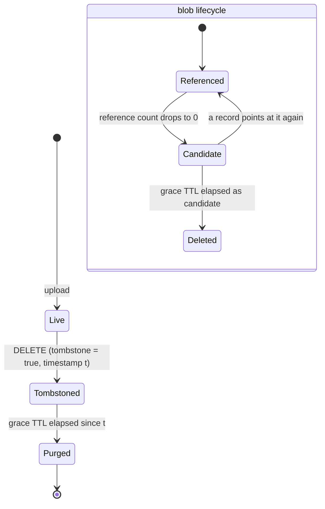

# Architecture

This document describes the system end to end, as it is built: what a node is,
how data is identified and placed, what happens on every read and write, how
replicas converge, how failures are detected and repaired, how deletion works,
and — just as important — what the system does **not** guarantee.

It complements, rather than replaces, the design spec
(`docs/superpowers/specs/2026-09-28-tag-based-distributed-store-design.md`): the
spec records the decisions and their rationale as they were made; this document
describes the resulting system as one piece, and every statement in it is meant
to match the code under `almacen/`. Where the implementation deliberately
departs from the spec, this document says so.

The comparison with CephFS, IPFS and semantic file systems requested by the
assignment is in [comparison.md](comparison.md). How to deploy a cluster is in
[deployment.md](deployment.md). The configuration variables, the REST API and
the full list of log events are in the [README](../README.md).

---

## 1. The problem, in one paragraph

Each file has a stable identity, content, a name and a set of tags. Clients can
upload, download, rename, replace content, delete, add and remove tags, and list
files matching a combination of tags. The cluster must keep working when nodes
fail or the network partitions, must handle concurrent updates to the same file
on different nodes, and must reconcile divergent replicas once the partition
heals. Content and metadata are replicated differently, so their freshness can
diverge, and the design has to state what a client can observe when it does
(section 13).

## 2. Design at a glance

| Concern | Decision | Section |
| --- | --- | --- |
| Consistency model | AP, eventually consistent, Dynamo-style | 3 |
| Node roles | One node type; every node is both a data node and a metadata node | 4 |
| Identity | Stable UUID per file, separate from the SHA-256 of its content | 5 |
| Content placement | Rendezvous hashing (HRW) of the content hash, R=3 of N=5 | 6 |
| Content durability | Write quorum W=2 of R=3, each replica flushed to disk; read from any one replica, verified by hash | 7, 13 |
| Metadata placement | Full replica on every node | 4, 7 |
| Metadata durability | Local commit flushed to disk, then best-effort push; no quorum | 7, 13 |
| Content vs metadata freshness | Content-first write order; every divergence case and what a client sees | 13 |
| Concurrent updates | CRDTs: LWW-registers, OR-Set of tags, vector clock per record | 8 |
| Failure detection | SWIM-style suspicion with incarnation-based refutation | 10 |
| Repair | Push-pull gossip of `file_id → vector clock` digests, plus blob catch-up | 11 |
| Deletion | Tombstones, grace TTL, reference-counted blob GC | 9 |
| Interfaces | REST (FastAPI) for clients, gRPC between nodes | 4 |
| Deployment | One Docker image, one `docker run` per node, no orchestration file | 14 |
| Observability | `GET /cluster/status` per node; structured (JSON) log events | 15 |
| Client | `almacen-cli` over the REST API, failing over between nodes | 16 |

## 3. Consistency model: why AP

The assignment explicitly asks for *treatment of concurrent updates* and
*reconciliation after partitions*. Both presuppose that replicas are allowed to
diverge. A CP design (Raft, Paxos, majority quorums on every operation) would
make the minority side of a partition refuse writes, so there would be nothing
to reconcile afterwards. The system is therefore built AP:

- **Every node accepts metadata operations** (rename, tag edits, delete,
  queries) as long as it is running, even when it is cut off from every peer.
- **Divergence is resolved after the fact** by merge functions that are
  commutative, associative and idempotent (CRDTs), so the order and number of
  times updates arrive do not matter.
- **Content writes are the exception that needs a quorum**: an upload succeeds
  only if W of the blob's R replicas store it (section 7). This is a durability
  requirement, not a consistency one — content is immutable, so there is
  nothing to be inconsistent about, only something to lose.

## 4. Node anatomy

There is exactly one kind of node. Every node runs the same image and the same
process, and plays every role:

```
             clients (almacen-cli, curl, browser, scripts)
                              |
                         REST / HTTP
                              |
+-----------------------------v------------------------------------+
| node                                                             |
|                                                                  |
|  api/  FastAPI routers: /files, /files/{id}/tags, /cluster/status|
|    |                                                             |
|    +--> ReplicatedMetadataStore --> MetadataStore (SQLite, WAL)  |
|    |       (write locally, then         full replica of every    |
|    |        push to all peers)          FileRecord + CRDT state  |
|    |                                                             |
|    +--> TagIndex (AND / OR queries over the local replica)       |
|    |                                                             |
|    +--> ReplicationClient ----------> BlobStore (filesystem)     |
|           HRW placement, W-of-R       blobs/<sha256>, only the   |
|           writes, verified reads      blobs this node is a       |
|                                       replica for                |
|                                                                  |
|  GossipLoop (background thread, every 5 s)                       |
|    gossip round -> blob catch-up -> GC                           |
|    Membership: SWIM-style alive / suspect / dead view            |
|    BlobGCState (SQLite, gc_state.db): when each orphan appeared  |
|                                                                  |
|  gRPC server: Cluster   (ReplicateRecord, Gossip, Ping)          |
|               Replication (PutBlob, GetBlob — streamed)          |
+-----------------------------^------------------------------------+
                              |
                         gRPC (internal)
                              |
                     the other N-1 nodes
```

Each node therefore holds:

- **all** metadata — every `FileRecord`, including tombstoned ones, with its full
  CRDT state (`almacen/storage/metadata_store.py`);
- **a shard** of the content — the blobs whose HRW replica set includes it
  (`almacen/storage/blob_store.py`).

### Why one node type

CephFS separates metadata servers (MDS) from object storage daemons (OSDs), and
the original framing considered the same. The split was rejected because what
it buys — independent scaling and different hardware for metadata and bulk data
— only matters at datacenter scale. At five nodes it would add a second image,
a second failure mode (losing the metadata tier) and a routing layer, with no
benefit. The separation is kept **in software** instead: `storage/`, `crdt/`,
`domain/`, `cluster/`, `rpc/` and `api/` are independent packages with one
responsibility each, so splitting roles across processes later would be a
deployment change, not a redesign.

A symmetric design also means there is no coordinator to elect and no single
point of failure: any node can serve any request.

### Why metadata is fully replicated

Content is large, so it is sharded (each blob on R of N nodes). Metadata is
small, so every node keeps all of it. That makes every tag query a **local**
operation: `GET /files?tags=a,b&mode=and` is answered from the receiving node's
own SQLite file without contacting anyone, and keeps working during a partition.
Sharding metadata would turn every tag query into a scatter-gather across the
cluster, whose latency is that of the slowest shard and whose availability is
that of the least available one.

The cost is that metadata storage and replication traffic grow with N × (number
of files). At the target scale that is negligible; at thousands of nodes it
would not be (see section 12).

### Two communication planes

- **REST over HTTP** (FastAPI, port 8000) for clients. Any node accepts any
  request.
- **gRPC** (port 50051) between nodes: `Replication.PutBlob` / `GetBlob` stream
  content in 1 MiB chunks (below gRPC's 4 MiB default message limit);
  `Cluster.ReplicateRecord` pushes a metadata record; `Cluster.Gossip` runs one
  anti-entropy exchange. Protos are in `almacen/rpc/*.proto`.

The gRPC port is not published to the host in the deployment: only nodes speak
it, inside the Docker network.

## 5. Data model: stable identity vs content hash

```
FileRecord                                   BlobStore (on R nodes)
+-------------------------------------+      +------------------------+
| file_id      UUID (never changes)   |      | blobs/9f86d0...        |
| name         LWW-register           |      |   immutable bytes      |
| content_hash LWW-register  --------------->|   address = SHA-256    |
| tombstone    LWW-register           |      +------------------------+
| tags         OR-Set                 |
| vector_clock {node_id: counter}     |
| created_at, updated_at              |
+-------------------------------------+
```

(`almacen/domain/file_record.py`, `almacen/crdt/`.)

Two identifiers, two jobs:

- **`file_id`** is a UUID assigned at upload. It is the file's identity for its
  whole life: renaming the file, replacing its content, adding or removing tags
  — none of it changes the `file_id`. Clients address files by it.
- **`content_hash`** is the SHA-256 of the current content. It is the address of
  a blob, not of a file. `PATCH` with new content stores a **new** blob and
  moves the record's pointer to it; the old blob is never modified.

Content addressing is therefore an implementation detail of the blob layer, and
it buys three things:

1. **Immutability.** A blob's bytes can never change under its address, so
   replicas of a blob can never disagree. That is why content needs no CRDT and
   why reading a single replica is enough (section 7).
2. **Integrity.** The address doubles as a checksum. Every read — local or
   remote — re-hashes the bytes, and `PutBlob` rejects content whose hash does
   not match the declared one (`almacen/rpc/replication_servicer.py`).
3. **Deduplication.** Two files with identical content share one blob.

What it does **not** give is a stable name for a changing file — which is why
identity is a separate UUID. A design where the identity *is* the hash (as in
IPFS) would give the file a new identity on every edit, and tags and names
would have to be re-attached to it. See [comparison.md](comparison.md).

**No version history.** `PATCH` replaces the content pointer; the previous
content is not retrievable through the API and becomes garbage once nothing
references it (section 9).

## 6. Placement: rendezvous hashing

A blob's replica set is chosen by **highest random weight (HRW, rendezvous)
hashing** over the content hash (`almacen/cluster/placement.py`):

```
score(node) = first 64 bits of SHA-256(f"{content_hash}:{node_id}")
replica_set = the R nodes with the highest (score, node_id)
```

Properties that matter here:

- **No placement metadata.** Every node computes the same replica set from the
  same inputs; there is no directory of "which blob lives where" to store,
  replicate or keep consistent.
- **Minimal disruption.** Adding or removing a node only moves the blobs for
  which that node enters or leaves the top R — about R/N of them — unlike
  `hash mod N`, which remaps almost everything.
- **Determinism.** Sorting on `(score, node_id)` breaks ties by node id, and the
  input is de-duplicated, so the result does not depend on the order of the
  peer list.
- **Read preference.** The ranking doubles as a read order: every node tries
  replicas in the same sequence.

HRW costs O(N) hashes per lookup, against O(log(N·V)) for a consistent-hash ring
with V virtual nodes. At N=5 that is five SHA-256 computations, invisible next
to the network I/O that follows; the ring's advantages appear only at hundreds
of nodes, and it is harder to implement correctly.

**Placement uses the configured peer list, not the live membership view.**
`replica_set` is always called with `settings.node_ids` — every node in
`ALMACEN_PEERS`. A node that is down or declared dead stays in the replica sets
it belonged to. This is deliberate for a cluster with static membership: it
avoids moving data every time a node is briefly suspected, and the node's blobs
are still there when it comes back. The consequence — no automatic
re-replication after a node is permanently lost — is listed in section 12.

## 7. Write and read paths

### Upload (`POST /files`)

```mermaid
sequenceDiagram
    participant C as Client
    participant X as Receiving node
    participant A as Replica A
    participant B as Replica B
    participant P as Every other peer

    C->>X: POST /files (bytes, name, tags)
    X->>X: hash = SHA-256(bytes); replicas = HRW top 3
    par write to every replica
        X->>A: PutBlob(stream)
        X->>B: PutBlob(stream)
        Note over X: plus a local put if X is itself a replica
    end
    A-->>X: ack
    B-->>X: ack
    alt acks >= min(W, replicas)
        X->>X: FileRecord.new(...) and commit to local SQLite
        X->>P: ReplicateRecord (best effort, all peers)
        X-->>C: 201 + metadata (file_id, ...)
    else fewer than W acks
        X-->>C: 503, no metadata written
    end
```

Step by step (`almacen/api/routers/files.py`,
`almacen/cluster/replication_client.py`):

1. The receiving node hashes the content and computes the replica set. It need
   not be in the replica set itself; if it is, its local write counts as one
   acknowledgement.
2. It writes to **all** R replicas in parallel and **waits for every attempt to
   finish** (each bounded by `ALMACEN_RPC_TIMEOUT_SECONDS`) before evaluating
   the quorum. Dynamo acknowledges as soon as the W-th ack arrives; waiting for
   all of them is slower but means a replica that was reachable always gets the
   blob, rather than leaving it to anti-entropy.
3. If at least `min(W, |replica set|)` replicas stored the blob, the write is
   durable enough. The `min` makes a single-node development deployment work.
4. Only then is the `FileRecord` created and committed to the local SQLite
   store, and pushed to every peer with `ReplicateRecord`. The push is
   synchronous but **best effort**: a peer that cannot be reached does not fail
   the request; anti-entropy will deliver the record later.
5. If the quorum is not reached the client gets `503` and **no metadata is
   written**, so no record can ever point at content that was not stored
   durably. Replicas that did accept the blob keep an unreferenced copy, which
   the garbage collector reclaims one grace TTL later (section 9).

The order — content first, metadata second — is what keeps the invariant
"metadata never references content below quorum". The reverse order would make
a file visible, cluster-wide, before its bytes exist.

### Metadata-only writes

Rename, add tag, remove tag and delete touch only the `FileRecord`. They:

1. run as an atomic read-modify-write under the local store's lock
   (`MetadataStore.mutate`), so two concurrent requests on the same node cannot
   lose each other's update;
2. check, *inside* that atomic section, that the record is not tombstoned — a
   file deleted between the check and the write cannot be resurrected;
3. stamp the mutation (vector clock increment and a monotonic timestamp,
   section 8) and commit locally;
4. push the record to every peer, best effort.

They need no quorum and succeed on any running node, partitioned or not.

`PATCH` with new content combines both paths: the new blob is written with the
W-of-R quorum first, outside the store lock (it is network I/O), and only then
is the record's `content_hash` repointed.

### Reads

- **Listing and tag queries** (`GET /files?tags=...&mode=and|or`) are answered
  entirely from the local metadata replica by `TagIndex`
  (`almacen/storage/tag_index.py`), which filters the live records with set
  containment (AND) or intersection (OR). This is a linear scan over live
  records, which is the right trade at this scale; an inverted index is the
  obvious next step and is not implemented.
- **Download** (`GET /files/{id}`) reads the record locally (404 if unknown or
  tombstoned), then fetches the blob: from local disk if this node holds it,
  otherwise from the replicas in HRW order, stopping at the first one that
  answers with bytes matching the hash. A corrupt copy — local or remote — is
  treated as a miss and the next replica is tried. If no replica can serve it
  the client gets `503`: the file exists, its bytes are temporarily
  unreachable.

### Why W=2 and reading one replica is enough

The textbook strict-quorum condition is `W + R_read > R`, so that every read
set overlaps every write set and a reader cannot see a stale value. Here
`W + R_read = 2 + 1 = 3`, which is not greater than R=3 — and that is correct,
because the condition protects against reading a *stale version*, and blobs
have no versions. A blob's address is the hash of its bytes, so a replica either
has exactly the right bytes or does not have the blob at all. The only possible
failure of a one-replica read is a miss, which falls through to the next
replica. Staleness exists only in the metadata (which name, which content hash,
which tags), and that is handled by CRDTs instead of quorums.

W=2 of R=3 means an acknowledged blob survives the loss of any one of its
replicas, and uploads keep working while any one replica of a given blob is
down.

## 8. Metadata convergence: CRDTs

Every node holds a full metadata replica and accepts writes independently, so
two nodes can change the same record concurrently. Convergence is guaranteed by
building `FileRecord` out of state-based CRDTs (`almacen/crdt/`) and merging
field by field (`FileRecord.merged`):

| Field | CRDT | Merge |
| --- | --- | --- |
| `name`, `content_hash`, `tombstone` | LWW-register | keep the higher `(timestamp, node_id)` |
| `tags` | Observed-remove set | union of adds, union of removes; visible = adds − removes |
| `vector_clock` | vector clock | component-wise max |
| `created_at` / `updated_at` | — | min / max |

Each of these merges is commutative, associative and idempotent, so the record
merge is too. That is what allows the same update to arrive by direct push and
again by gossip, in any order, any number of times, and every replica to end in
the same state. These laws are checked over randomized histories in
`tests/unit/domain/test_merge_laws.py`.

### Tags: OR-Set

Each `add(tag)` records a unique occurrence `(tag, node_id, counter)`, where the
counter is the record's vector-clock component for that node. `remove(tag)`
cancels only the occurrences **this replica has observed**. A tag added on one
side of a partition while it is removed on the other therefore survives the
merge — the remove did not observe that add. "Add wins over a concurrent
remove" is the behaviour a user expects from tagging: a concurrent remove never
silently erases someone else's new tag. Both the add and the remove sets are
persisted (`file_tag_adds`, `file_tag_removes`); dropping the removes would
resurrect tags on the next merge.

### Single-value fields: LWW-registers with monotonic timestamps

A name or a content pointer cannot be merged meaningfully, so one value wins:
the one with the higher `(timestamp, node_id)`. The `node_id` tie-break makes
the choice deterministic on every replica.

Plain wall-clock timestamps would make this unsafe. Each mutation is instead
stamped `max(now, newest timestamp already on this record + 1 µs)`
(`FileRecord._touch`). The timestamp is therefore strictly increasing along each
record's causal history, which guarantees that **a write always outranks every
write it has observed**, even if the writing node's clock is behind. Without
this floor, a delete issued on a node with a lagging clock could lose to the
record's own creation and the file would come back; two writes inside one clock
tick could leave replicas disagreeing forever.

### Delete always wins over a concurrent edit

`tombstone` is a third LWW-register, written only by `DELETE`. A concurrent
rename or tag edit never writes to the tombstone field, so it cannot produce a
competing value for it; and the delete's timestamp is above the field's initial
value by the monotonic floor. After merging, the record is tombstoned. The
concurrent edit's own fields still merge into the stored record, but the record
is invisible through the API. There is no undelete operation.

### Vector clocks: detection, not resolution

Each record carries one vector clock; every local mutation increments the
mutating node's component. The clock answers "has this copy seen everything the
other has?" exactly, and is used for two things:

- **Anti-entropy**: comparing clocks decides which records two nodes need to
  exchange (section 11).
- **Conflict visibility**: when a remote record's clock is concurrent with the
  local one, the node logs a `concurrent_update_resolved` warning with both
  clocks before resolving by LWW, so a discarded concurrent write is visible in
  the logs rather than silent. Both receive paths check, through the shared
  `almacen/cluster/conflicts.py`: `ReplicateRecord` (direct pushes and the push
  half of a gossip exchange, logged by the responder) and the pull half in
  `gossip_once` (logged by the initiator, with the responder as `sender`).

The clock deliberately does **not** take part in the merge. An earlier version
of the spec let a dominating clock win outright; that rule breaks
associativity (a merged clock can dominate a record it never descended from),
so replicas receiving the same updates in different groupings would diverge.
The useful part of that rule — a later write beats an earlier one — is already
provided by the monotonic timestamps.

### Concurrency inside one node

HTTP requests, gRPC handlers and the gossip thread all use the same SQLite
connection. A lock in `MetadataStore` serialises access, and every
read-modify-write (`mutate`, `merge_remote`) happens inside a single locked
section, so no update acknowledged by a node can be lost to a concurrent update
on the same node. Blocking replication work runs in a thread pool rather than on
the event loop, so one slow peer does not stall other requests.

## 9. Deletion and garbage collection

Deletion is the one place where this system destroys data, in a system whose
anti-entropy otherwise *restores* missing data from peers. The whole design of
this section follows from keeping those two from fighting each other.



1. **Tombstone.** `DELETE` sets the record's `tombstone` register to `true`.
   Nothing is physically removed. From that moment the file is a `404` on
   **every** endpoint of the node that processed the delete — download, tags,
   rename, tag edits — exactly as if it had never existed.
2. **Propagation.** The tombstone travels like any other update: pushed to
   peers immediately (best effort) and carried by anti-entropy, which includes
   tombstoned records in its digests on purpose. Until it reaches a node, that
   node still serves the file. This is the AP model's normal inconsistency
   window, not a special case.
3. **Purge after a grace TTL.** A tombstoned record whose tombstone is at least
   `ALMACEN_GRACE_TTL_SECONDS` old (default 24 h) is removed from the store
   (`MetadataStore.purge`, its tag occurrences included). The TTL is measured
   from when the delete *originated* — the tombstone's own timestamp — not from
   when this node learned of it: it bounds how long the tombstone has had to
   reach every peer, which is a property of the delete, not of the observer. A
   tombstone without a timestamp is never considered expired.
4. **Blob reference counting.** On each round, every node counts how many of its
   own records — **including tombstoned, not-yet-purged ones** — point at each
   blob it holds (`MetadataStore.reference_counts`). A blob with zero references
   becomes a *candidate*, and the moment it became one is persisted in a
   separate SQLite file, `gc_state.db` (`almacen/storage/gc_state.py`).
   Re-marking an existing candidate does not restart its clock. A candidate
   that is still unreferenced one grace TTL later is deleted from disk; one
   that regains a referrer (identical content re-uploaded, or a record
   re-learned through gossip) stops being a candidate.
5. **Scheduling.** GC is the third step of each gossip tick, after the gossip
   round and blob catch-up (`GossipLoop.run_once`). Running after catch-up
   avoids deleting a blob in the same tick a record that needs it was learned.
   Within one GC round records are purged first and references recounted
   afterwards, so a blob orphaned by this round's purge becomes a candidate in
   the same round rather than a tick late. At most `ALMACEN_GC_BUDGET` (default
   32) irreversible operations — purges plus blob deletions — run per round, and
   the loop's stop flag is checked before each, so GC can neither monopolise a
   tick nor delay shutdown. GC runs on the gossip loop, so disabling gossip
   (`ALMACEN_GOSSIP_INTERVAL_SECONDS` ≤ 0) disables it too.
6. **No re-adoption of expired tombstones** (next subsection).

The rules themselves are pure functions of the records, the candidate table and
the time (`almacen/cluster/gc.py`: `is_expired_tombstone`, `records_to_purge`,
`blobs_to_delete`); `collect` applies them to one node's stores.

### Why the grace TTL is a safety property

A purged record is indistinguishable from a record the node has never seen. If
a node purges a tombstone while some partitioned peer still holds the live
version, the next gossip round after the partition heals teaches that live
version back — the deletion is silently undone. The grace TTL is the window
during which every peer is expected to have received the tombstone; **it must
exceed the longest partition (or outage) the deployment intends to survive**.
Too short resurrects deleted files; too long only costs disk space. The demo
deployment shortens it to 20 s so the lifecycle is observable, which is safe
only because demo partitions last seconds.

### Expired tombstones are not re-adopted

This rule is not in the design spec; it was added after the steps above proved
insufficient on their own. On a live five-node cluster the purged record kept
coming back — never as a live file, but as a tombstone that bounced between
nodes indefinitely. The cause is the order of a tick: each node gossips
*before* it collects, and nodes purge on their own ticks, so at any moment some
have purged a given tombstone and some have not yet. To the digest comparison
(section 11), a node that has purged the record is simply missing it, so a peer
that still holds it sends it over; the purged node adopts it, purges it again a
tick later, and in the meantime hands it on to another node that had already
purged it.

The fix is a rule at the point of adoption. `MetadataStore.merge_remote` takes a
`refuse_unknown` predicate, consulted only when the store does **not** hold the
incoming record, under the same lock as the insert. Both receive paths pass
`is_expired_tombstone` with the node's grace TTL:

- the gossip pull, when the initiator merges the records in the responder's
  reply (`gossip_once`);
- `ClusterServicer.ReplicateRecord`, which receives both direct pushes and the
  push half of every gossip exchange.

So a node refuses a record it does not hold when that record is a tombstone
already past the grace TTL. Why this is safe:

- **It cannot resurrect anything.** Refusing an expired tombstone is equivalent
  to adopting it and purging it in the same instant — the node would purge it on
  its next round anyway, by the same predicate. Only an incoming *live* copy can
  resurrect a file, and live records are never refused.
- **It does not weaken deletes.** A record the node *does* hold always merges.
  So a node that was partitioned for longer than the TTL and still holds the
  file live does receive the expired tombstone, the merge tombstones its copy,
  and it purges on its next round. (What the rule cannot do is help once every
  other node has already purged: then nobody has a tombstone to send, the live
  copy is taught back, and the delete is undone — which is exactly the
  "partition longer than the TTL" hazard above.)
- **It stops the bounce.** A node that has purged a tombstone can no longer be
  taught it back, so once each node's own GC has removed an expired tombstone
  it stays removed, and the record disappears from the cluster.

### Both orphan paths, one mechanism

A blob becomes unreferenced in two ways:

- its record is **deleted and later purged**: the tombstoned record keeps
  referencing the blob until the purge, so the blob becomes a candidate only
  then and is deleted one TTL later — about **two TTLs after the delete**, which
  deliberately errs towards over-retention: the record's TTL protects nodes that
  have not heard of the delete, the blob's protects nodes that may still need to
  read the content;
- a live record is **repointed by `PATCH`**: the old blob loses its referrer
  immediately and is deleted one TTL later.

A blob that no record ever referenced (left behind by an upload that missed its
quorum) is a candidate by the same rule.

Measured on a live five-node cluster with a 20 s TTL and 2 s gossip interval:
the record was purged on every node about 22 s after the `DELETE`, its blob
deleted from its replicas about 42 s after it (two TTLs), and the blob orphaned
by a `PATCH` about 20 s after the `PATCH`. The extra seconds are the wait for
the next tick.

Reference counts are **local**: each node counts its own full metadata replica.
No distributed reference count is needed, because every node eventually holds
every record, and the grace TTL covers the window before a referrer created
elsewhere arrives. The remaining race — identical bytes re-uploaded between the
recount and the deletion — costs only that node's copy: the record survives, and
blob catch-up (section 11) fetches the content back from another replica.

The candidate table is persisted because it cannot be recomputed: once the last
referrer is gone, nothing else remembers when that happened. Losing it would be
safe (every timer would restart, so blobs are kept longer, never deleted early),
but a node that restarts often would then never collect anything.

### Not collected

The OR-Set's remove set is never pruned. Dropping a remove while any peer still
holds the matching add would resurrect the tag, and doing it safely requires
knowing that every node has observed the removal (causal stability), a separate
mechanism this design does not have. Tag metadata of long-lived, heavily
re-tagged files therefore grows without bound.

## 10. Membership and failure detection

`almacen/cluster/membership.py` keeps, on every node, a view of every peer as
**alive**, **suspect** or **dead**, each with an incarnation number. It is a
simplified SWIM: the core ideas (suspicion before death, refutation by
incarnation, dissemination by gossip) without SWIM's indirect probes.

```
          contact fails                      suspicion timeout (15 s)
 ALIVE  ---------------->  SUSPECT  ---------------------------------->  DEAD
   ^                          |                                           |
   +--------------------------+-------------------------------------------+
          any successful contact (incarnation + 1)
```

- **Probing is the gossip exchange itself.** There is no separate heartbeat: a
  gossip RPC that fails marks the peer suspect; one that succeeds marks it
  alive. The responder also marks the caller alive, so detection is
  bidirectional at no extra cost. (A `Ping` RPC exists but the loop does not use
  it.)
- **Suspicion, not death.** One failed exchange is as likely a dropped packet as
  a dead node. A peer becomes dead only after staying suspect for
  `ALMACEN_SUSPICION_TIMEOUT_SECONDS`, and only the first failure starts that
  clock — otherwise repeated failures would keep postponing it forever.
- **Dissemination.** Each gossip message carries the sender's view. When views
  disagree, the higher incarnation wins; at equal incarnation the worse state
  wins, so a real failure spreads instead of being argued away.
- **Refutation.** A node that hears it is suspected or dead bumps its own
  incarnation above the claim, and its "alive" report then outranks it.
- **Local clocks only.** A received state is re-stamped with the receiver's
  clock, so suspicion deadlines never depend on another machine's clock.

The view is used for one thing: choosing gossip partners — each round picks up
to `ALMACEN_GOSSIP_FANOUT` random peers that are not dead. It does **not**
change placement (section 6) or the replica set of a write: membership is
static (`ALMACEN_PEERS`), and the failure detector exists to avoid wasting
rounds on dead peers and to make the cluster's view of itself observable
(`GET /cluster/status`, section 15).

Like any failure detector in an asynchronous system it can be wrong — a slow
node is indistinguishable from a dead one — and it is designed to be wrong only
transiently: any successful contact corrects it.

## 11. Anti-entropy and partition healing

Direct pushes (`ReplicateRecord`) are best effort; anything they miss — because
a peer was down, partitioned or slow — is repaired by a background loop
(`almacen/cluster/gossip.py`). Every `ALMACEN_GOSSIP_INTERVAL_SECONDS` (default
5 s) each node runs one tick:


Both receive paths — the initiator merging B's reply, and B merging the
`ReplicateRecord` pushes — refuse to adopt an expired tombstone they do not
hold (section 9).

### The digest comparison

For each `file_id`, the responder compares its vector clock with the initiator's
(`almacen/cluster/reconciliation.py`):

| Initiator's clock vs responder's | Action |
| --- | --- |
| absent on one side | the side that has it sends it |
| equal | nothing — the steady state |
| one dominates | the newer side sends |
| concurrent | **both** send, and the CRDT merge combines them |

Only records that differ cross the network. Tombstoned records are included in
the digest deliberately: a tombstone is the update that most needs to arrive.

### Content catch-up

Metadata is not enough: a node that was partitioned during an upload may be an
HRW replica for a blob it never received. After each gossip round the node
walks its live records and, for every blob **it is a replica for** and does not
hold, fetches it from another replica (verified by hash). It never fetches blobs
it is not a replica for, so catch-up restores the sharding instead of copying
the whole corpus everywhere. At most `ALMACEN_BLOB_CATCHUP_BUDGET` blobs are
fetched per tick so a long catch-up cannot hold up the loop or its shutdown;
the rest is picked up on later ticks.

### Partition and healing, end to end

```
time ──────────────────────────────────────────────────────────────────▶

          partition                                heal
 {1,2,3,4} │ {5}                                     │  {1,2,3,4,5}
 ──────────┼─────────────────────────────────────────┼───────────────────
 upload F on node1:                                  │ node5 gossips, receives
   blob -> its replicas among 1-4;                   │ F's record (and the tag),
   if node5 is a replica, its PutBlob fails          │ merges by CRDT; if it is
   but W=2 is still met -> 201                       │ a replica for F's blob,
 record pushed to 2,3,4; push to 5 fails             │ catch-up fetches it.
 node5: tags F's sibling G while isolated ───────────┤ node5's edit to G reaches
   (local write, succeeds)                           │ the others the same way.
 node5 suspected, then dead in others' views         │ first successful contact:
                                                     │ alive again.
```

The README's partition demo performs exactly this with
`docker network disconnect` / `connect`.

### Convergence speed and its limits

Peer choice is random, so convergence time is probabilistic: a prototype of
this exchange on five nodes needed a median of about 12 rounds to converge a
change and up to 23 in the worst of 200 trials. The tests therefore use a
deterministic peer chooser rather than random rounds. The digest is
O(number of records) per exchange even when nothing has changed; Merkle-tree
digests, which make the steady state O(log n), are deferred (spec §11, §17).

## 12. Guarantees — and what is not guaranteed

### Guaranteed

- **Convergence (strong eventual consistency of metadata).** Any two nodes that
  have received the same set of updates, in any order and any number of times,
  hold identical metadata. Given connectivity, gossip delivers every update to
  every node eventually.
- **No acknowledged content below quorum.** An upload or content `PATCH` that
  returned success was stored by at least `min(W, R)` replicas, verified by
  hash on receipt and flushed to disk by each, so it survives a power loss of
  the whole cluster and the loss of any one replica's disk (section 13).
- **Acknowledged metadata survives a crash or power loss** of the node that
  accepted it: the local commit is flushed to disk before the reply.
- **No metadata pointing at unwritten content.** A record is created or
  repointed only after its blob reached quorum.
- **Integrity.** Every blob served to a client hashes to its address; corrupt
  copies are skipped.
- **Concurrent tag edits are never lost.** An add concurrent with a remove of
  the same tag survives.
- **A write beats what it observed.** Monotonic per-record timestamps make a
  causally later write win LWW regardless of clock skew.
- **Delete wins** over concurrent edits of the same file, and a deleted file is
  a `404` on every endpoint of every node the tombstone has reached.
- **No resurrection** after purge, provided every partition (and every node
  outage) is shorter than the grace TTL.
- **A purge sticks.** A tombstone past the grace TTL is never re-adopted by a
  node that no longer holds the record (section 9), so expired tombstones do not
  circulate between nodes after they are purged.
- **Local atomicity.** No update acknowledged by a node is lost to a concurrent
  update on the same node.
- **Availability of metadata operations** on every running node, including a
  partitioned one; reads of content as long as one replica of the blob is
  reachable.

Most of these are checked together, under randomized fault schedules (splits,
one-way link cuts, crashes and restarts, each shorter than the grace TTL), by
the chaos suite in `tests/chaos/`: convergence, consistency with the
acknowledged operations, integrity of every read, no resurrection, and that GC
never collects a blob a live record references while still collecting every
orphan. The README's Test section explains how to run it and reproduce a seed.

### Not guaranteed

- **Linearizability or read-your-writes across nodes.** A client that writes to
  node1 and reads from node5 may see the old state until the update arrives.
  Same-node read-your-writes does hold.
- **Preservation of both sides of a concurrent rename or content change.** LWW
  keeps one; the other is not surfaced to clients. Dynamo-style sibling
  versions are out of scope. The conflict is logged on every receive path
  (section 8), but only on the node that detects it: a conflict between two
  nodes shows up in whichever node's log merged the other's version first.
- **Which concurrent write wins is clock-dependent.** Between genuinely
  concurrent writes, the node with the faster clock wins. A node with a badly
  fast clock drags a record's timestamps forward.
- **Uploads during heavy failure.** No sloppy quorum and no hinted handoff: if
  two of a blob's three HRW replicas are unreachable, that upload fails with
  `503` even though other nodes are up. (Metadata operations are unaffected.)
- **Durability of a metadata write against disk loss at acknowledgement.** A
  metadata write is acknowledged after the local commit, flushed to disk; the
  push to peers is best effort. If the node's disk is lost before any peer
  received the record, the write is lost. A crash or power loss, after which
  the node restarts with its volume, loses nothing: gossip delivers the record
  then. Section 13 states exactly when this window is open and why no metadata
  quorum closes it.
- **Re-replication after permanent node loss.** Placement uses the static peer
  list, so a node that never comes back leaves its blobs one replica short;
  nothing copies them elsewhere. Membership changes (adding or removing nodes)
  require reconfiguring and restarting every node.
- **Byzantine tolerance or security.** Nodes trust each other; there is no
  authentication, authorisation or TLS on either plane.
- **Bounded metadata size.** OR-Set remove sets are never pruned; digests grow
  linearly with the number of records.
- **Version history.** Previous content is not retrievable.
- **Exact or synchronised GC timing.** Each node purges and collects on its own
  gossip tick, against its own clock, so nodes remove the same record and the
  same blob at slightly different moments. A tombstone's age is measured from
  the deleting node's timestamp, so a slow clock there makes every node purge
  sooner (bounded below by the record's own creation time, section 8).
- **Prompt disk reclamation.** A deleted file's content stays on disk for about
  two grace TTLs, by design (section 9).

## 13. Consistency and durability: content vs metadata

Content and metadata are replicated by two different mechanisms — a W-of-R
quorum on a hash-chosen replica set for the bytes, a local commit plus a best
effort push to every node for the record — so each has its own consistency and
durability, and their freshness on a given node can diverge. This section
states both precisely and lists every way the two can disagree, with what a
client sees in each case and the test that pins it down.

### What a successful response means

| | Consistency | Durability |
| --- | --- | --- |
| **Content** (blobs) | **Immutable and content-addressed**, so there are no versions to be stale: a node either holds exactly the right bytes or nothing. Every blob served is verified against its hash, so a client never receives wrong bytes, only — at worst — a `503` when no replica can serve it. | A `201`/`200` for an upload or content `PATCH` means at least `min(W, R)` = 2 of the blob's 3 HRW replicas each wrote it to a temporary file, flushed it (`fsync`), renamed it into place and flushed the directory (`BlobStore.put`). It therefore survives a **process crash** or a **node crash** of any node, a **power loss** of the whole cluster (to the extent the disks honour `fsync`), and the **loss of any one replica's disk**. It is lost only if both acknowledging replicas lose their disks before the third replica has fetched it (catch-up, section 11), or if two replicas are lost permanently (no re-replication, section 12). |
| **Metadata** (records) | **Eventual, convergent** (strong eventual consistency, section 8): reads are answered from the local replica and may be stale relative to another node; same-node read-your-writes holds; concurrent updates merge deterministically (OR-Set tags, LWW name and content pointer, delete wins). | A `2xx` for any write means the record was committed to the local SQLite store in WAL mode with `synchronous = FULL` — the WAL is flushed on every commit — and that a push to every peer was **attempted and finished** (each bounded by the RPC timeout) before the reply. It survives a **process crash**, **node crash** or **power loss** of the accepting node: the record is still on its disk at restart and gossip delivers it. It survives the **loss of the accepting node's disk** if at least one peer had received it (by the push or by a gossip round) before the disk died. Otherwise it is lost. |

Two remarks on the metadata row.

**When the loss window is actually open.** Because the push is synchronous, the
acknowledged record is already on every peer that was reachable at the time.
The window is therefore open only for writes made while the node was cut off
from *every* peer, and closes at the node's first successful gossip round after
it reconnects. For uploads and content `PATCH` it is narrower still: the content
quorum required `W - 1 ≥ 1` other node to be reachable an instant before the
record push. If the window does close badly for an upload, the client was told
`201` for a file that disappears: its blob, unreferenced on its replicas, is
collected one grace TTL later as an orphan (section 9) — the content-first order
ensures nothing dangles, but the acknowledged file is gone.

**Why no metadata quorum.** A write quorum on metadata would close that window
only by refusing writes on the minority side of a partition, which is exactly
what the AP model (section 3) exists to avoid: the assignment requires
reconciliation after partitions, which presupposes that both sides accepted
writes. Nor is a quorum needed for consistency: CRDT merges make any replica's
copy mergeable with any other's, so there is nothing for a quorum to agree on.
What a quorum would buy is durability against the loss of an isolated node's
disk, a narrow event, at the price of availability on every metadata write. The
content side is different: losing an acknowledged blob would leave every node's
record pointing at bytes that no longer exist anywhere — a permanent `503` — so
the quorum is paid there.

### The write order invariant

Every content write follows the same order (section 7): **blob to quorum first,
then the record**. A record is created or repointed only after its blob was
acknowledged by `min(W, R)` replicas, and an upload that misses the quorum
writes no record at all. So **no record, on any node, ever points at content
that did not reach quorum**. Whatever divergence a node observes, it is always
one of the benign cases below: metadata may lag content (an orphan, collected
later) or point at content this node does not hold (fetched from a replica), but
never at content that was never durably stored.

### Freshness divergence: every case

"Stale" below means the node has not yet received an update made elsewhere,
because the push did not reach it and no gossip round has delivered it yet.
Every case ends the same way: the next gossip round that reaches the node
brings its metadata up to date, and blob catch-up restores its replica copies.

| Case | What a client sees on the lagging node | Proven by |
| --- | --- | --- |
| **Metadata ahead of content locally**: the node has the record but not the blob (it is not a replica, or it is a replica that missed `PutBlob`). | `200` with the right bytes, fetched from a replica in HRW order and verified. A replica that missed the blob fetches it on its next tick. | `tests/integration/cluster/test_replication_client.py::test_get_blob_fetches_from_a_replica_when_absent_locally`, `tests/cluster/test_five_node_cluster.py::test_a_file_uploaded_to_one_node_downloads_from_every_other`, `tests/integration/cluster/test_blob_catchup.py::test_a_replica_missing_its_blob_fetches_it`, `tests/integration/cluster/test_partition_healing.py::test_a_node_that_missed_an_upload_gains_the_record_and_its_blob` |
| … and no replica can serve the blob (all unreachable or all lack it). | `503`: the file exists, its bytes are unreachable. Never `404`, never wrong bytes. | `tests/integration/api/test_cluster_error_paths.py::test_download_returns_503_when_no_replica_holds_the_blob` |
| **Content ahead of metadata**: the blob reached this node, its record has not (an upload between its blob writes and its record push, or a push that missed this node). | `404` for the file and absent from listings, until the record arrives; then `200`. The blob's GC clock starts, but the grace TTL leaves time for the record to arrive, after which the blob is referenced and kept. | `tests/integration/cluster/test_freshness_divergence.py::test_content_whose_record_has_not_arrived_is_invisible_and_not_collected_early` |
| … and the record never arrives (upload missed its quorum, or the accepting node's disk died before propagating it). | `404` forever, everywhere; the orphan blob is deleted one grace TTL after it was first seen unreferenced. | `tests/integration/api/test_cluster_error_paths.py::test_no_metadata_is_recorded_when_the_write_quorum_fails`, `tests/integration/cluster/test_gc.py::test_a_stray_blob_with_no_record_is_collected_after_one_ttl` |
| **Stale metadata after a remote content `PATCH`, within the grace TTL**: the node's record still points at the old hash. | `200` with the **old** content (and old name/tags): a coherent earlier version, served from the old blob, which is unreferenced on up-to-date nodes but kept for one grace TTL. | `tests/integration/cluster/test_freshness_divergence.py::test_a_node_that_missed_a_remote_patch_serves_the_old_content`, `::test_within_the_grace_ttl_the_old_content_stays_readable` |
| **Stale metadata after a remote content `PATCH`, beyond the grace TTL**, on a node that is not a replica of the old blob. | `503`: up-to-date replicas have collected the old blob. After the next gossip round, `200` with the new content. | `tests/integration/cluster/test_freshness_divergence.py::test_beyond_the_grace_ttl_a_stale_node_answers_503_until_gossip_reaches_it` |
| … on a node that is a replica of the old blob. | `200` with the old content indefinitely: reference counts are local, and the node's own stale record keeps its copy alive until the new record arrives. | `tests/integration/cluster/test_freshness_divergence.py::test_a_stale_node_that_is_a_replica_keeps_the_old_blob_it_still_references` |
| **Tombstone not yet propagated**: the file was deleted elsewhere. | `200` with the content, and the file is listed; edits there are accepted and later lose to the delete. After the tombstone arrives, `404` on every endpoint. | `tests/integration/cluster/test_freshness_divergence.py::test_a_node_the_tombstone_has_not_reached_still_serves_the_file`, `tests/integration/cluster/test_convergence.py::test_a_delete_on_one_node_outlasts_an_edit_on_another`, `tests/integration/cluster/test_partition_healing.py::test_a_delete_during_a_partition_reaches_the_isolated_node` |
| **Tombstone not propagated within the grace TTL** (a partition longer than the TTL). | As above while partitioned, then `503` once the content's replicas have collected it (two TTLs after the delete) if the node is not a replica. On healing, the delete is undone if every other node has already purged the tombstone — the resurrection hazard of section 9. | `tests/integration/cluster/test_no_resurrection.py::test_purging_before_the_peer_saw_the_delete_resurrects_the_file`, `::test_gc_within_the_ttl_keeps_the_tombstone_so_the_delete_wins`, `::test_an_expired_tombstone_still_deletes_a_stale_live_copy` |
| **New file not yet propagated**: uploaded elsewhere, record not here. | `404` and absent from listings and tag queries; then visible after the next round. | `tests/integration/cluster/test_partition_healing.py::test_a_write_made_while_a_node_was_away_reaches_it_on_healing` |
| **Stale name or tags** after a remote rename or tag edit. | The old name, and tag queries answered with the old tag set: a file may be missing from, or wrongly included in, a result. | `tests/integration/cluster/test_partition_healing.py::test_edits_on_both_sides_of_a_partition_survive`, `tests/integration/cluster/test_metadata_replication.py::test_reads_are_served_locally` |
| **Concurrent content `PATCH`** on two nodes. | Each node serves its own version until they exchange records; then every node serves the LWW winner. The loser's blob is orphaned and collected one TTL later. | `tests/unit/domain/test_merge_laws.py`, `tests/integration/cluster/test_gc.py::test_a_patch_orphaned_blob_is_collected_after_one_ttl` |

Two properties hold in every row. A client never receives bytes that do not
match the record it was served from — the blob is addressed by its hash — so
staleness shows up as an *older coherent version*, a `404` for something not yet
known, or a `503` for something known whose bytes are gone; never as a mix of
versions. And every divergence is transient given connectivity, with the single
exception of the partition-longer-than-TTL hazard, which is a configuration
constraint (section 9).

The grace TTL thus bounds two freshness windows at once: how long a stale node
can keep serving a superseded version (the old blob's lifetime on up-to-date
replicas) and how long a tombstone has to reach every node before it is purged.
Both are "longest partition the deployment intends to survive".

## 14. Deployment model

There is one image (`docker/Dockerfile`) because there is one kind of node. A
cluster is deployed by hand: `docker build`, `docker network create` (a
user-defined bridge, so containers resolve each other by name), one named volume
per node, and one `docker run` per node with its own `ALMACEN_NODE_ID` and the
same `ALMACEN_PEERS` list. There is no Compose file or other orchestration —
the course forbids docker-compose, and typing each command keeps every
deployment decision explicit. [deployment.md](deployment.md) has the full
step-by-step and the reason for every flag.

```
host
 ├── :8001 ─▶ node1 ─┐
 ├── :8002 ─▶ node2 ─┤   almacen-net (user-defined bridge, embedded DNS)
 ├── :8003 ─▶ node3 ─┤   gRPC :50051 between nodes, not published
 ├── :8004 ─▶ node4 ─┤
 └── :8005 ─▶ node5 ─┘   each with volume almacen-nodeN-data at /data
```

- **Configuration** comes entirely from environment variables (`almacen/config.py`,
  table in the README). The peer list must include the node itself and be
  identical on every node, or nodes would rank different node sets for
  placement.
- **Persistence**: `/data/blobs/` (one file per blob, written to a temp file,
  flushed and renamed, so a crash never leaves a partial blob and a power loss
  never loses an acknowledged one), `/data/metadata.db` (SQLite in WAL mode with
  `synchronous = FULL`, section 13) and `/data/gc_state.db` (the GC candidate table,
  section 9). A stopped and restarted container resumes with its data, and its
  GC timers keep running from where they were.
- **Logs**: the image sets `ALMACEN_LOG_FORMAT=json`, so `docker logs` emits one
  JSON object per line (section 15).
- **Failure injection**: `docker stop` / `docker start` for crashes;
  `docker network disconnect` / `connect` for partitions.
- **Demo timings**: the documented commands shorten the gossip interval (2 s),
  the suspicion timeout (6 s) and the grace TTL (20 s), so reconciliation,
  failure detection and garbage collection are observable within a session.
  The defaults (5 s, 15 s, 24 h) are the production values; the 20 s TTL is safe
  only because demo partitions last seconds (section 9).

## 15. Observability

A distributed system is demonstrated by showing what each node believes, and
two nodes can legitimately believe different things during a partition. Both
observability mechanisms are therefore **per node**: there is no aggregated
cluster view, and none is needed to follow a demo.

### `GET /cluster/status`

Any node answers with its own view (`almacen/api/routers/cluster.py`,
response models in `almacen/api/schemas.py`):

| Field | Content |
| --- | --- |
| `node_id` | The answering node |
| `members` | Every node in its membership view, itself included, sorted by id: `node_id`, `address` (from `ALMACEN_PEERS`), `state` (`alive` / `suspect` / `dead`), `incarnation`, `since` (when this node last saw that member change state; `null` for itself and for a peer never seen to change), `is_self` |
| `replication` | `replication_factor`, `write_quorum`, `rpc_timeout_seconds` |
| `gossip` | `enabled`, `interval_seconds`, `fanout`, `suspicion_timeout_seconds`, `blob_catchup_budget` |
| `gc` | `grace_ttl_seconds`, `budget` |
| `storage` | `live_records`, `tombstones`, `blobs` — counts of this node's local state |

The membership part is one `Membership.snapshot` taken under the membership
lock, so it is a consistent cut even while the gossip thread merges into it.
The storage counts are read separately (each exact, not taken at the same
instant as the membership). Record counts come from a `GROUP BY` over the
`files` table rather than decoding every record. Once gossip has converged,
`live_records` and `tombstones` should agree on every node, because metadata is
fully replicated; `blobs` differs, because each node holds only its shard. A
`tombstones` count that falls to zero after the grace TTL is the visible effect
of section 9's purge. The handler is a plain `def`, so FastAPI runs its blocking
SQLite and filesystem reads on a worker thread rather than the event loop.

### Structured logging

Logging is configured once, before the app is built
(`almacen/observability.py`, called from `almacen/main.py`). structlog events
and standard-library records — including uvicorn's own loggers, whose handlers
are replaced so they propagate — go through one `ProcessorFormatter`, so the
whole stream has one format:

- `ALMACEN_LOG_FORMAT=console` (the default) renders coloured lines for a
  terminal; `json` renders one JSON object per line. The Docker image sets
  `json`, so `docker logs` output can be filtered by field.
- `ALMACEN_LOG_LEVEL` (default `INFO`) is the minimum level.
- Every entry carries `event`, `level`, `logger`, an ISO-8601 UTC `timestamp`
  and a `node_id`. The node id is a *default* taken from `ALMACEN_NODE_ID`;
  components bind their own, which keeps several in-process nodes
  distinguishable in the test suite.

Cluster code logs **named events with key/value fields**, not sentences: a round
of gossip is `gossip_round_completed` with `peer`, `pulled` and `pushed`; a
membership transition is `member_state_changed` with `from_state`, `to_state`
and a `reason`, logged once per transition as this node first observes it; GC
logs `tombstone_purged`, `blob_collected` and, when a round removed anything,
`gc_round_completed` (idle rounds stay silent). Failures carry an `error` field
holding the gRPC status code (`UNAVAILABLE`, `DEADLINE_EXCEEDED`) rather than
gRPC's multi-line error text. An unreachable peer during gossip is logged at
`info`, since it is the routine case anti-entropy exists for; a peer that fails
after answering is a `warning`. The three steps of a gossip tick each have an
exception backstop (`gossip_round_crashed`, `blob_catchup_crashed`,
`gc_round_crashed`) that logs the traceback and lets the loop continue.

The complete table of events, their levels and fields is in the README's
[Observability](../README.md#observability) section, and is not repeated here.

## 16. Command-line client

`almacen-cli` (`almacen/cli/`, a Typer application installed as a console
script by `pip install -e .`) covers every REST endpoint — `upload`, `list`,
`download` (alias `get`), `update`, `delete`, `tag list|add|remove`, `status` —
so the cluster can be operated without curl. It is a pure REST client: it has
no access to gRPC and no knowledge of placement, and relies on the fact that any
node can serve any request (section 4). Usage is in the README.

### Failover between nodes

`--node` (or `ALMACEN_NODE_URL`) accepts a comma-separated list of node URLs.
`NodeClient` (`almacen/cli/client.py`) sends each request to the first node in
the list and moves on to the next **only on a connection error** —
`httpx.ConnectError` or `httpx.ConnectTimeout`, i.e. errors raised before the
request reached any node. A warning names each node skipped.

It never fails over once the request may have reached a node:

- a node that answered — with any status, including `404` or `503` — is final:
  the error is reported, not retried elsewhere;
- a read or write timeout after the connection was established is reported, not
  retried.

The reason is that not every write in the API is idempotent. An upload
creates a new `file_id` each time, and retrying a `POST /files` whose response
was lost would store the file twice under two identities; a repeated `PATCH` or
tag edit would be stamped as a second, causally later write. Because the CLI cannot tell
whether a node that stopped responding mid-request applied it, it only retries
when it knows the node did not.

Two consequences of the design:

- The node that answered moves to the front of the list, so a command issuing
  several requests (`tag remove` sends one per tag) pays a dead node's connect
  timeout once, not per request.
- Consecutive requests of one command, or consecutive commands, may be served by
  different nodes after a failover, and are then subject to the cross-node
  staleness of sections 12 and 13: a write just made through one node may not
  yet be visible through the next.

To make failover possible, request bodies are sent as bytes, not streams: an
upload reads the whole file into memory so the same body can be sent to the
next node.

Exit status separates the failure modes: `0` success, `1` a node answered with
an error, `2` a usage error, `3` no node could be reached. `--json` prints the
raw API response instead of a table. `status` reports a node that does not serve
`/cluster/status` (an older version) as such, rather than as a generic `404`.

## 17. Code map

| Package | Responsibility |
| --- | --- |
| `almacen/domain/` | `FileRecord`: the CRDT-backed entity, mutations and merge. No I/O. |
| `almacen/crdt/` | `LWWRegister`, `OrSet`, `VectorClock`. Pure. |
| `almacen/storage/` | `BlobStore` (filesystem), `MetadataStore` (SQLite: records, merge, purge, reference counts), `TagIndex` (queries), `BlobGCState` (SQLite: GC candidates and when each became one) |
| `almacen/cluster/` | Placement (HRW), replication client (W-of-R), metadata replicator, membership, reconciliation, gossip loop and blob catch-up (`gossip.py`), GC rules and collector (`gc.py`), conflict logging (`conflicts.py`) |
| `almacen/rpc/` | Protos, generated stubs, servicers (`ReplicateRecord` and `Gossip` apply the expired-tombstone refusal), codecs between records and messages |
| `almacen/api/` | FastAPI routers (`files`, `tags`, `cluster`), schemas, dependency providers |
| `almacen/cli/` | `almacen-cli`: Typer commands per resource, `NodeClient` with connection-only failover, output rendering |
| `almacen/observability.py` | structlog and stdlib logging configuration (console or JSON) |
| `almacen/config.py` | `Settings` from the environment |
| `almacen/main.py` | Configures logging, wires one node together; the lifespan starts gRPC and then gossip, and stops them in reverse order |
